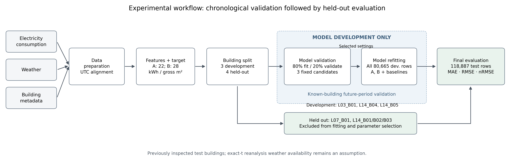
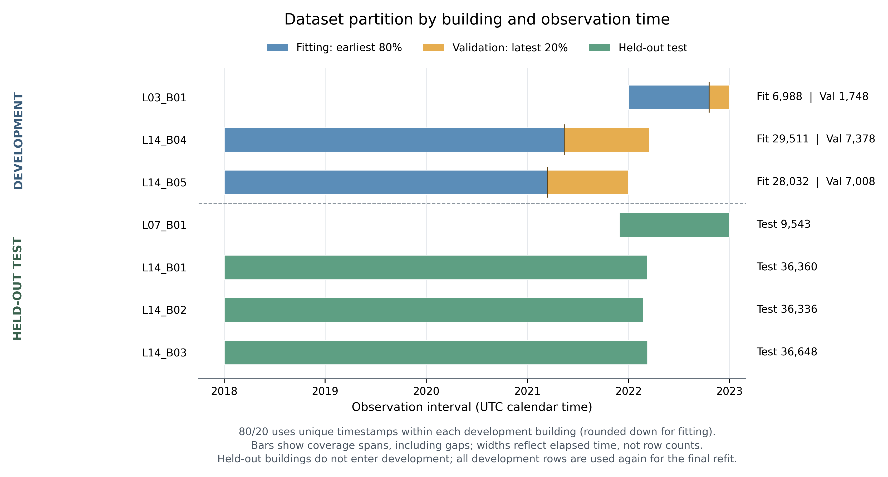
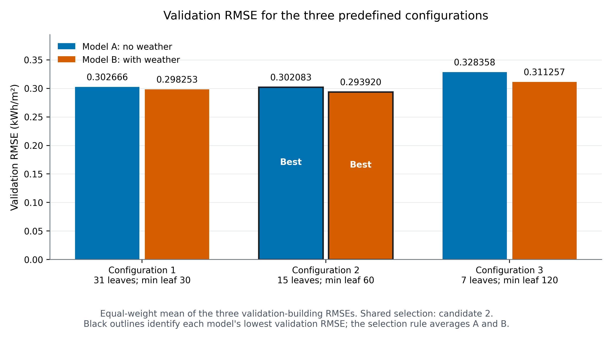
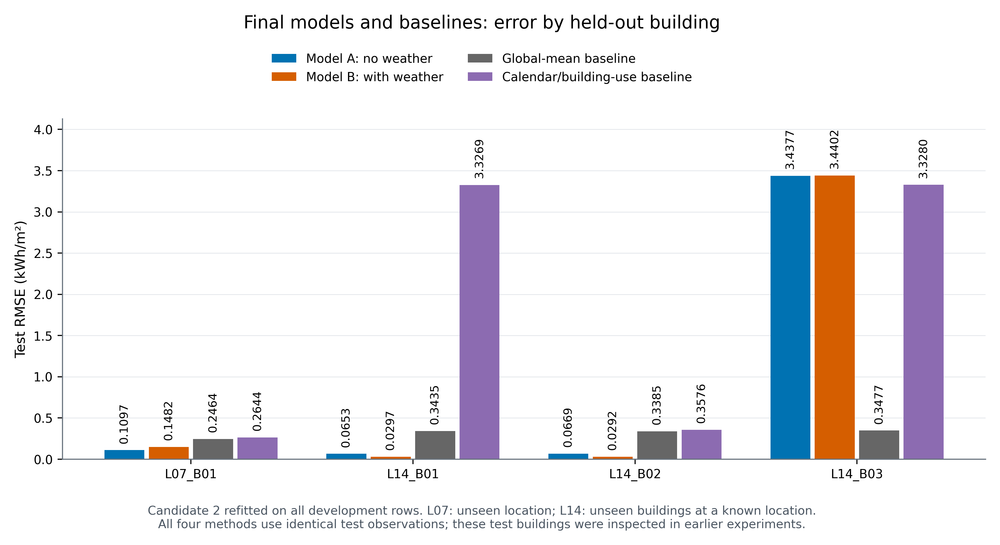
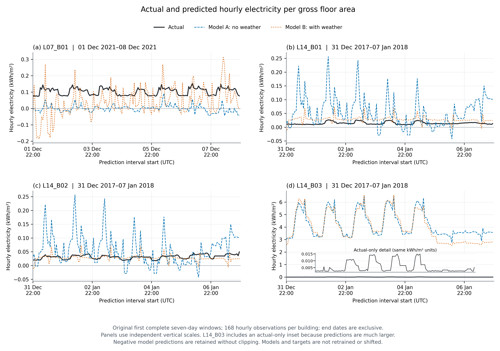
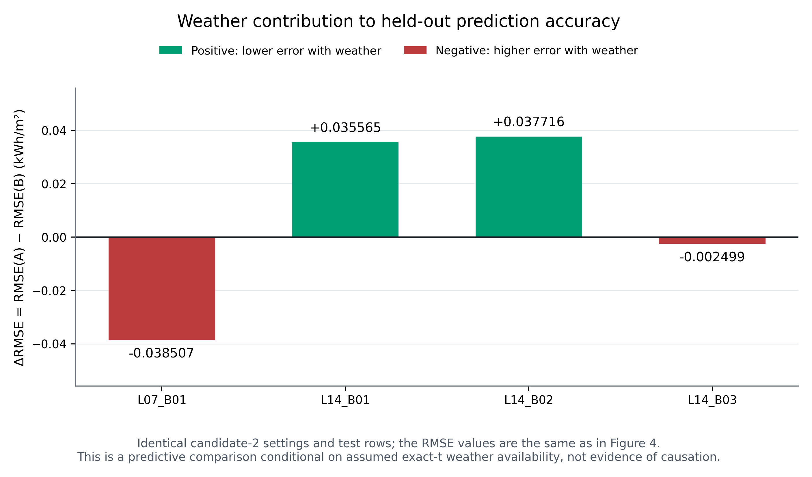

# Academic report figure captions

Source experiment: `Prediction Model/experiments/validation/run_20261025T091525_455049Z`. Selected setting: `candidate_2`. No fitting, target shifting, clipping or source changes.

## Figure 1



Experimental workflow for predicting hourly electricity consumption per gross floor area. L03_B01/L14_B04/L14_B05 supply per-building chronological validation and full-development refitting; L07_B01/L14_B01/B02/B03 bypass model development and enter only held-out evaluation. The tests were previously inspected and exact-t reanalysis weather availability is assumed.

Files: `figure_1_workflow.png` (320 DPI); `figure_1_workflow.svg` (editable vector text).

## Figure 2



Chronological coverage and partition membership for all seven buildings. Within each development building, the earliest floor(80% of unique interval-start timestamps) fit the methods and the remaining timestamps validate them. Held-out buildings are excluded from development. Bar widths show elapsed time over coverage spans, including gaps, rather than observation counts; cutoffs differ by building and all development rows are subsequently used for refitting.

Files: `figure_2_data_split.png` (320 DPI); `figure_2_data_split.svg` (editable vector text).

## Figure 3



Validation RMSE for the three predefined HistGradientBoostingRegressor configurations, averaged equally across the three validation buildings. Black outlines identify the lowest value for each model. Configuration 2 (15 leaf nodes; minimum leaf size 60) is best for both and is selected by the predefined mean of A/B macro RMSEs. All other settings, features and fitting/validation rows are fixed across candidates.

Files: `figure_3_validation_rmse.png` (320 DPI); `figure_3_validation_rmse.svg` (editable vector text).

## Figure 4



Held-out test RMSE for Models A/B and the global-mean and calendar/building-use baselines after refitting on all 80,665 development rows. Values are recomputed from identical held-out observations for each building. L07 is an unseen location, whereas L14 holdouts are unseen buildings within a represented location. These previously inspected tests are a validation-guided follow-up, not an untouched final test.

Files: `figure_4_test_rmse.png` (320 DPI); `figure_4_test_rmse.svg` (editable vector text).

## Figure 5



Actual and candidate-2 predicted hourly electricity consumption per gross floor area over the original first complete seven-day window for each held-out building (168 hourly observations; UTC). All three series in a panel share identical timestamps. Panels use independent vertical scales; L14_B03 has an explicitly actual-only inset to reveal demand variation obscured by its much larger prediction errors. Negative forecasts are retained without clipping. Windows are fixed from the original experiment and were not selected for prediction quality.

Files: `figure_5_actual_vs_predicted.png` (320 DPI); `figure_5_actual_vs_predicted.svg` (editable vector text).

## Figure 6



Weather-related change in test RMSE, ΔRMSE = RMSE(A) − RMSE(B), using exactly the building-level values in Figure 4. Positive values indicate lower error with weather; negative values indicate deterioration. Both models use the same validation-selected settings and test observations. Differences are conditional predictive evidence under the exact-t weather assumption and do not establish a causal weather effect.

Files: `figure_6_weather_contribution.png` (320 DPI); `figure_6_weather_contribution.svg` (editable vector text).

## Reproduction

Requires numpy, pandas and matplotlib (exact versions in figure_manifest.json).

```bash
"Prediction Model/.venv/bin/python" -m pip install numpy pandas matplotlib
PYTHONDONTWRITEBYTECODE=1 '/Users/bakani/Desktop/E.Consumption_predictionModel/Prediction Model/.venv/bin/python' -B '/Users/bakani/Desktop/E.Consumption_predictionModel/Prediction Model/generate_report_figures.py' --output-dir /Users/bakani/Desktop/E.Consumption_predictionModel/Prediction Model/charts
```

Existing filenames are protected. After this generation, use `--output-dir` with a fresh folder to render again. The original six chart images in the main charts folder were removed by the user before this task; this report set replaces that folder's contents. Existing experiment-specific charts remain unchanged.
